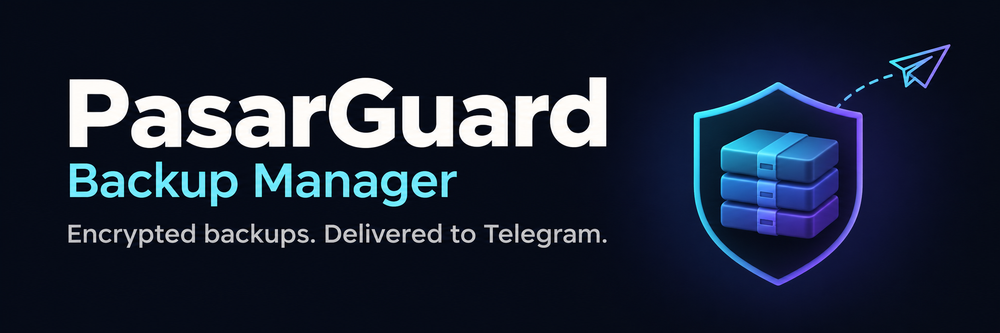

# PasarGuard Backup Manager



Back up your PasarGuard panel and send the files to your **Telegram channel**, automatically or whenever you choose.

## Features

- Easy menu with arrow keys and number shortcuts.
- Detects your PasarGuard installation and remembers your settings.
- Encrypts backups before uploading them to Telegram.
- Splits large backups into smaller files and retries failed uploads.
- Lets you browse backups, check files, and see recent results.
- Runs backups on a schedule you can change or pause at any time.

**No manager process stays running between backups.** Closing the menu exits the interface. Scheduled backups start only when due and exit when finished.

## Quick setup

Use this on the **Linux server where PasarGuard is installed**. The installer handles the required tools on Debian/Ubuntu; Python 3.9 or newer is required. PasarGuard and Docker must already be working.

### 1. Install the manager

Download this project to your server and open its folder, then run:

```bash
sudo bash install.sh
```

If you use Git, you can download and install it with:

```bash
git clone https://github.com/mojtabaesl/pg-backup.git
cd pg-backup
sudo bash install.sh
```

The installer opens the setup menu. To open it again later:

```bash
sudo pg-backup
```

### 2. Connect your Telegram channel

Create a bot through [@BotFather](https://t.me/BotFather), then add it to your channel as an administrator with **Post Messages** permission. A private channel is recommended for backups.

Setup asks for the bot token and the channel ID only if they have not already been detected or saved. A public channel can use its `@username`; a private channel uses an ID beginning with `-100`.

**The channel receives the files. The bot only posts them.** The connection to Telegram is direct, with no proxy setup.

### 3. Save your recovery key and start backing up

Backups are **encrypted by default**. Setup creates a recovery key at `/etc/pg-backup/recovery-key.txt`. Save a copy on your own computer or in a password manager, separately from the server and backup channel. You can view it under **Storage and encryption**.

**If you lose the server and your only copy of this key, you cannot open your encrypted backups.** Confirm that you have saved the key separately, review the defaults, and enable automatic backups when ready. [Recovery on another server](#recovering-after-losing-your-server) is possible with your downloaded backup files and this key.

Choose **Back up now → Telegram channel** for your first backup, then check that the files arrived in your channel.

## Defaults and everyday use

| Setting | Default |
| --- | --- |
| Automatic backups | Every 6 hours, once enabled |
| Local copies | Keep the last 7 successfully uploaded backups |
| Encryption | Enabled |
| Upload file size | Up to 45 MB per part |
| Upload retries | 3 |

Schedules follow **your server's timezone**, which the menu displays. Automatic backups stay paused until you enable them during setup.

Settings are labelled **Detected**, **Default**, or **Saved**. Press **Enter** to keep a displayed value. Changing one setting does not make you enter everything again. Use **↑/↓** and **Enter** to navigate, or **q/Esc** to go back.

To pause automatic backups, use the schedule menu or run:

```bash
sudo pg-backup disable
```

Failed uploads and local-only backups are kept until you delete them yourself, so check storage occasionally. Automatic cleanup removes older local copies of successfully uploaded backups; it never deletes posts from your Telegram channel.

If something fails, open **Status, logs and diagnostics**. For Telegram connection problems, choose **Telegram channel settings → Test direct IPv4 / IPv6 connection**, or run `pg-backup telegram-network`. IPv4 is tried first; no proxy is needed when it works.

If setup says your PasarGuard management script is too old, follow the [official management script instructions](https://github.com/PasarGuard/scripts) to update it. This manager does not update your panel.

## Useful commands

Most actions are available in the menu. These shortcuts are useful when you want to run something directly on your server:

| What you want to do | Command |
| --- | --- |
| Open the manager | `sudo pg-backup` |
| Finish or review setup | `sudo pg-backup setup` |
| Back up now and send to the channel | `sudo pg-backup run` |
| Make a local backup without uploading | `sudo pg-backup run --local-only` |
| Retry pending uploads | `sudo pg-backup retry` |
| List local backups and their IDs | `sudo pg-backup list` |
| View settings and the latest result | `sudo pg-backup status` |
| Check direct Telegram connectivity | `pg-backup telegram-network` |
| Check the server for problems | `sudo pg-backup diagnose` |
| Send a small test file to the channel | `sudo pg-backup test-upload` |
| Enable automatic backups after setup | `sudo pg-backup enable` |
| Pause automatic backups | `sudo pg-backup disable` |

See **[all commands and options](docs/commands.md)** for recovery, checking files, resending backups, and more. You can also run `pg-backup --help`, or add `--help` after a command, such as `pg-backup recover --help`.

## Recovering after losing your server

**Yes, you can open your encrypted backups on another server or computer, even if the original server is completely lost.** You need:

- **Every part of the chosen backup and its `manifest.json` file**, downloaded from your Telegram channel into the same folder.
- **The recovery key you saved separately**. It is not included in the uploaded backup files.

Recovery does not need access to the original server or its Telegram bot token. Keep the recovery key for as long as you keep encrypted backups. **Losing your only copy of the key means losing access to those backups.**

On the replacement server or computer, download this project and install Python 3.9+ and `age`. From the project folder, run the following command, replacing the example paths with your own:

```bash
python3 pg-backup recover /path/to/manifest.json \
  --identity /path/to/recovery-key.txt \
  --output /path/to/recovered-backup.zip
```

The manager checks the files, joins the parts, and decrypts them into a normal PasarGuard backup ZIP. Choose a new output filename; existing files are never overwritten. No PasarGuard installation or administrator access is needed to recover the ZIP itself.

To restore the panel on your replacement server, follow the [official PasarGuard recovery guide](https://github.com/PasarGuard/scripts/blob/main/docs/backup-and-restore.md). Recovering the ZIP does not change or restore a running panel. You can find more details in the [recovery command reference](docs/commands.md#recover-a-downloaded-backup).

## Removal

Wait for any backup currently running to finish. Then stop automatic backups and remove the manager:

```bash
sudo pg-backup disable
sudo rm /usr/local/bin/pg-backup
sudo rm -r /opt/pg-backup
```

This keeps your PasarGuard panel, Telegram posts, saved settings, recovery key, and local backups.

Your recovery key and settings remain in `/etc/pg-backup`, and local backups remain in `/var/lib/pg-backup/backups`. Copy anything you need somewhere safe before deleting those folders. **Keep your recovery key for as long as you keep encrypted backups.**

## Try the menu without installing

From the downloaded project folder, run:

```bash
python3 pg-backup --demo
```

The demo needs no server or Telegram credentials and makes no network requests or server changes. Add `--plain` if you prefer a simple numbered menu.
